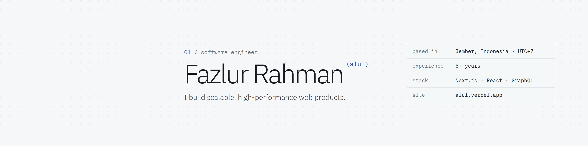
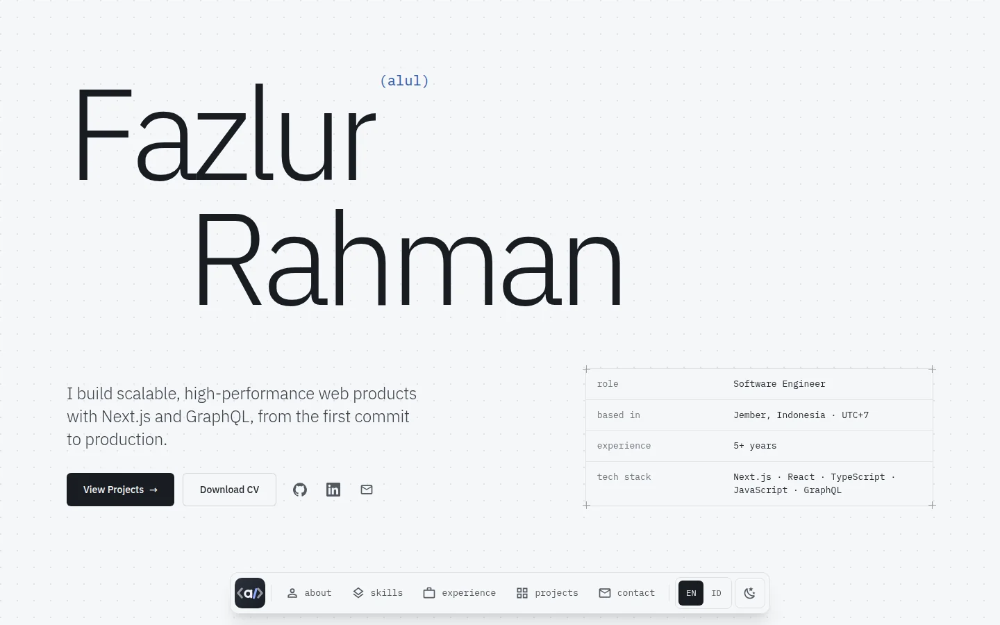

### Hi, I'm Alul 👋

I'm a software engineer from Indonesia with 5+ years of experience building web applications and SaaS products from the ground up. Most of my work lives where complex business logic meets everyday users: omnichannel dashboards, low-code page builders, and e-commerce platforms.

I'm **open to software engineering roles and freelance projects**. Email is the fastest way to reach me.

  
  
  
  

| | |
| --- | --- |
| `role` | Software Engineer |
| `based in` | Jember, East Java, Indonesia · UTC+7 |
| `experience` | ICUBE · ICUBE by SIRCLO · Barito Technologies Group |
| `education` | S.Stat. (Statistics), Institut Teknologi Sepuluh Nopember |

### What I've built

Most of my work lives in private company repositories, so the case studies are on my site: the problem, what I did, and the result.

- **[Belanjaku](https://alul.vercel.app/en/projects/belanjaku-seller-dashboard)**: led the frontend of ICUBE's own e-commerce ecosystem from architecture to production. 3 products (Seller Dashboard, Storefront, Affiliate) now used by 10+ merchants, plus a [Creator dashboard](https://alul.vercel.app/en/projects/belanjaku-creator) where creators build and sell templates and widgets.
- **[SwiftOMS](https://alul.vercel.app/en/projects/swiftoms)**: largest frontend contributor (2,200+ commits, 53% of the total) to an omnichannel order management system synced with 4 marketplaces.
- **[SWIFT Hub](https://alul.vercel.app/en/projects/swift-hub)**: led the MVP of a multi-tenant seller hub for small businesses, built on the SwiftOMS codebase.
- **[WAVES-SSI](https://alul.vercel.app/en/projects/waves-ssi)**: built a bilingual learning platform end to end as a freelance project for a university research consortium.
- **[KlikDiabetes](https://alul.vercel.app/en/projects/klikdiabetes)**: launched a React Native health tracking app with 10K+ downloads on Google Play.

### Tools I use

  
   
  

### My portfolio

<a href="https://alul.vercel.app/">
  <picture>
    <source media="(prefers-color-scheme: dark)" srcset="assets/hero-dark.webp" />
    
  </picture>
</a>

English and Indonesian, light and dark mode, built with Next.js 16, React 19, TypeScript, and Tailwind CSS 4.
